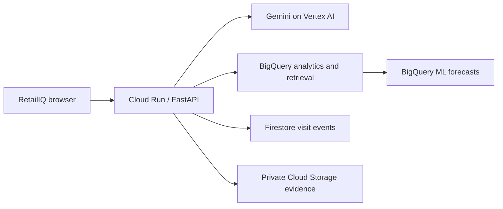

# RetailIQ

**Sensing. Execution. Empowerment. One accountable retail visit.**

RetailIQ is a field execution copilot for consumer packaged goods (CPG) retail. A field representative captures shelf evidence, checks an inventory discrepancy, prepares a source-linked conversation and saves an action a manager can review. The rep and store buyer retain the commercial decision. Shopper discovery is a secondary digital surface grounded in the same catalogue.

The challenge fit is **Retail & Commerce: Intelligent Customer and Business Experiences**, through inventory intelligence, demand planning, conversational discovery and operational efficiency.

## Try the application

Open the [prototype](https://retailiq-free-20261018-7ce297.web.app/). The direct Cloud Run backend has passed 14 actual checks, including real Gemini output, Firestore save/read and workspace isolation. Firebase same-origin publishing and browser QA are pending. The [optional recorded walkthrough](https://retailiq-free-20261018-7ce297.web.app/?demo=recorded) makes no AI calls. The site originally shipped on Firebase Spark; its hosting project now has an explicitly approved billing link for an allowance-limited live rollout. Free-tier allowances can be exceeded, so hosting is not a guaranteed zero-cost deployment. The direct Cloud Run backend is verified; end-to-end Firebase browser verification is still pending. Hosting retains an explicit public-file allowlist. The former billed-project Cloud Run endpoint is retired. Watch the [3-minute 42-second submission video](https://retailiq-free-20261018-7ce297.web.app/demo.html). Its AI-assisted narration uses the creator-provided voice sample, converted locally. The [final MP4](demo/RetailIQ_Abhishek_voice_demo.mp4) and [hosted PDF](https://retailiq-free-20261018-7ce297.web.app/pitch-slides.pdf) are also available.

```powershell
npm ci
npx playwright install chromium
python -m http.server 5190 --bind 127.0.0.1
```

Open **http://localhost:5190/index.html?demo=recorded**. The guided scenario requires no model key and is labelled as a recorded example. It uses a real shelf reference and synthetic commercial context; it is not live Gemini inference. Remove `?demo=recorded` to explore the static workspace.

The current static profile is `free_only`, with optional Google AI Studio access. Settings requires confirmation that the key belongs to a project with billing disabled. A quota error stops further requests for that page session; there is no paid fallback. The app cannot verify a key's billing status. The recorded walkthrough sends no AI requests even when a key is stored. This free profile has policy and browser regressions; its actual model quality has not been measured.

The prepared public judge profile uses Cloud Run, real Firestore and a separate unbilled Gemini API project, with an explicitly synthetic catalogue. It checks the key project is unbilled before each model call, shares persistent daily limits, and isolates browser sessions with a signed HttpOnly cookie. Direct backend checks passed; Firebase browser verification is pending; see [live deployment instructions](gcp/LIVE_DEPLOYMENT.md). The historical backend also implements Vertex AI and BigQuery. Company credits are a separate metered path.

## Who uses it and why

| User | Job in the workflow | Intended value |
| --- | --- | --- |
| CPG field representative, primary user | Capture the shelf, verify the discrepancy, prepare the conversation, draft the next action and debrief | Less duplicated administration; a defensible action before leaving the store |
| Field manager | Inspect saved visit evidence and proposed orders; prioritize unresolved issues | A reviewable handoff and more consistent execution |
| Store buyer or authorized approver | Validate counts, commercial terms and the proposed order | Human control over commitments |
| Shopper, secondary user | Describe a need and compare catalogue options, nutrition, price and availability | More useful product discovery |

## Why this problem

The [May 2026 Corsten, Gruen and LaBrecque paper](https://doi.org/10.1108/IJRDM-09-2025-0758) reports out-of-stocks around 8% and examines 55 international retailers. It links shelf availability to the alignment of sensing, execution and empowerment. RetailIQ applies that triad: a detected gap should lead to a verified task, a prepared person and a saved record. This is a design rationale, not evidence that RetailIQ has improved availability.

A separate [Rekik et al. working paper](https://arxiv.org/abs/2506.05357) studies about 24,000 SKUs in 11 stores and reports an 11% sales lift associated with audits in its quasi-experiment, concentrated where system stock exceeded actual stock. It motivates checking discrepancies; it is neither a RetailIQ result nor an expected uplift. This arXiv working paper is not represented as peer reviewed.

## A 90-second judge walkthrough

1. **Sense.** Open the guided shelf scenario. Compare the shelf evidence with Protiva's assigned planogram. Own-brand compliance and competitor benchmarking answer different questions.
2. **Execute.** Confirm observations. An empty shelf with positive system stock calls for locating stock and filling the shelf. A purchase recommendation uses demand, available and inbound units, case size and shelf life. Facings are never treated as unit inventory.
3. **Empower.** Inspect the cited pitch and its supporting document. Published sources and synthetic brand evidence are labelled separately. Backend factual pitch claims are rendered from retrieved passages.
4. **Save and review.** Save the audit or proposed order and open Team & Analytics to inspect the event. Static mode saves in this browser; configured cloud mode writes Firestore and can retain evidence privately.

A proposed order is a draft for review. RetailIQ does not place an ERP order or accept a commercial commitment automatically.

## What is implemented

| Surface | Main functions |
| --- | --- |
| Field Execution | Visit prioritization, cited pitches, separate buyer roleplay and scoring, own-brand shelf audits, competitor benchmarks, guided counts, suggested orders, targets and debriefs |
| Team & Analytics | Revenue and forecast intervals, inventory alerts, segment profiles, team reference figures, saved visit events and manager review |
| Shopper Insights | Conversational discovery grounded in catalogue prices, nutrition, stock, preferences and basket context |

### Evidence and decisions

- Video capture samples frames, ranks sharpness and passes selected frames to Gemini vision. A still image provides a narrower field of view.
- Each audit criterion is `PASS`, `FAIL` or `NOT VISIBLE`. Missing visibility is not a pass.
- Own-brand compliance checks the assigned planogram. Competitor benchmarking describes visible execution without claiming access to a private competitor plan.
- Shelf counts and system stock are separate evidence. An empty facing is not proof that all store inventory is gone.
- Replenishment uses a forecast when available and a labelled trailing-sales fallback otherwise. Short-life products are limited by shelf life; inbound stock reduces the order.
- Audit and debrief results belong to the visit that started them. Context changes must not transfer unfinished results to another visit or shopper.
- Managers can inspect the saved event and, when explicitly retained in configured cloud mode, retrieve the photo through authenticated private access.

### Grounded language

Backend pitches retrieve passages from BigQuery and accept only retrieved source identifiers. Factual claim text is rendered from those passages. A valid citation identifier alone is not treated as proof for an invented sentence. The interface preserves the synthetic/published distinction.

General chat and rehearsal are model-generated assistance. Prompt instructions and formatting cleanup are not a guarantee against hallucination or prompt injection. Model text is rendered as text; warehouse text is escaped before HTML display.

## Google Cloud implementation



The container serves the frontend and API together. `runtime-config.js` selects the deployment profile. A warehouse failure is shown instead of silently substituting fixture data. Private IAM access is the cloud deployment default; an explicit shared-demo mode uses an application access token. Secret Manager keeps server credentials out of the repository.

See [the cloud guide](gcp/README.md). A historical reference deployment used Gemini 3.6 Flash through Vertex AI's global endpoint, with commerce services in Mumbai. That endpoint is retired. Company backend migration is an optional future path requiring an approved project. The active Firebase host serves the static free-only profile, with an optional unbilled AI Studio key and Gemini 3.5 Flash-Lite; historical reference-model results do not validate that model.

## Data and provenance

**Protiva, buyers, accounts, commercial figures, targets, shopper profiles and generated training history are synthetic.** The canonical JSON-compatible object in `retail_data.js` is shared by the browser, seed generator and backend. The scenario date is pinned for reproducibility.

Shelf sample media is real in-store footage. Protiva is fictional and absent from that media. Competitor branding shows what is visible; it is not an endorsement or evidence of private trade terms. A limited crop is not a complete 44-facing bay.

[INDUSTRY_EVIDENCE.md](INDUSTRY_EVIDENCE.md) records source provenance and method limits; [DATA_PLAN.md](DATA_PLAN.md) describes possible routes to real data. Industry statistics do not convert synthetic brand evidence into measured outcomes. `OTHER` in seed rows is a non-sellable aggregate for remaining turnover and must not appear as a recommended product.

## Verification

```powershell
npm test
.\.venv\Scripts\python.exe -m pytest tests/test_api.py tests/test_deploy.py tests/test_deploy_free.py -q -p no:cacheprovider
```

The active free Firebase host passed **18 HTTP/browser checks**, including published asset hashes, private-path rejection, the saved local audit workflow, phone layouts and zero AI/backend requests. The retained local release evidence records **157 browser checks, seven policy checks, 38 evaluator checks and 60 Python checks**. Separate historical reports record 10/10 live reference-model cases, 22 cloud checks and six recorded-browser checks. Those historical results do not establish current company-hosting availability or free-tier model quality. The final media has nine synchronized scenes, passed full-stream decoding and passed six public-media checks including native browser playback. Credential-free reports are in [submission/evidence](submission/evidence); [SUBMISSION_READINESS.txt](SUBMISSION_READINESS.txt) explains their scope.

The Node runner starts and stops its own local server. Python uses cloud doubles. Offline evaluation validates known facts, calculations and citations and rejects deliberately wrong responses; it is not measured Gemini quality. A seven-day forecast holdout on synthetic history produced 1.249% WAPE against a 2.824% seasonal-naive baseline. Synthetic-data performance is diagnostic, not production forecast accuracy. See [tests/README.md](tests/README.md).

## Illustrative business case: assumptions to validate

This is an editable scenario, not a measured saving or financial return. It scopes audit preparation and debrief administration, not the entire visit.

| Assumption or calculation | Monthly scenario |
| --- | ---: |
| 10 reps x 6 visits/day x 22 days | 1,320 visits |
| Assumed 12-minute baseline minus 5-minute target | 7 minutes released per visit |
| 1,320 x 7 / 60 | 154 hours of capacity |
| 154 hours x assumed loaded labor rate of INR 300/hour | INR 46,200 capacity value |
| Target operating budget of INR 5/visit x 1,320 | INR 6,600 |
| Capacity value less target operating budget | INR 39,600 |

Released time becomes financial value only if put to productive use. The operating budget is a target, not an observed bill. This scenario excludes implementation, integration, training and device costs. Free prototype AI access depends on an unbilled project's quota; a company deployment consumes metered resources and applicable credits.

## Pilot criteria: targets, not achieved outcomes

Use a documented two-week baseline and a comparable assisted period. Measure:

- Time from capture to an actionable record: test the five-minute target for the scoped task.
- Precision against independently annotated shelf observations, including abstention when evidence is insufficient.
- Stock discrepancy closure and replenishment completion, with a named human reviewer.
- Recommendation waste risk, order acceptance and productive use of released time.
- Source-supported factual claims, inference latency and observed cost per completed workflow.

There is no established RetailIQ sales uplift, stockout reduction or ranking prediction. Real operational evidence is required.

## Submission packet

**Team RetailIQ:** Abhishek Agarwal (team leader) and Vivek Sharma (team member). The presentation follows all 13 substantive template sections in order; the download-instruction page and blank end pages are omitted. [Public GitHub source](https://github.com/abhishek-0706/AI-BUILDER-CUP-2026) is verified without authentication.

- [pitch-slides.pdf](pitch-slides.pdf) / [HTML presentation](pitch-slides.html): 13-slide pitch following the mandatory template's substantive section order, with speaker notes in HTML.
- [Submission video](https://retailiq-free-20261018-7ce297.web.app/demo.html) / [final MP4](demo/RetailIQ_Abhishek_voice_demo.mp4): 3:42.44, with AI-assisted narration from the creator-provided voice sample. Recorded scenario; no live AI requests.
- [Earlier baseline video](demo/RetailIQ_submission_walkthrough.mp4): 117-second Windows-voice version retained locally.
- [SUBMISSION_BRIEF.txt](SUBMISSION_BRIEF.txt): complete ready-to-paste description below 1,024 characters.
- [Five form fields](submission/FORM_FIELDS.txt): verified links, final PDF metadata and the description.
- [Template compliance](submission/TEMPLATE_COMPLIANCE.txt): original-to-final section mapping.
- [SUBMISSION_READINESS.txt](SUBMISSION_READINESS.txt): artifact index, evidence scope and remaining release conditions.
- [submission/evidence](submission/evidence): shareable verification reports without model credentials.

## Repository map

- `index.html`, `commerce-api.js`, `runtime-config.js`: application and deployment adapter.
- `retail_data.js`: shared synthetic fixture with provenance.
- `gcp/`: API, warehouse schema, queries, forecasts and deployment scripts.
- `tests/`: browser, API and evaluation regressions.
- `demo/samples/`: real shelf media and sample assets.
