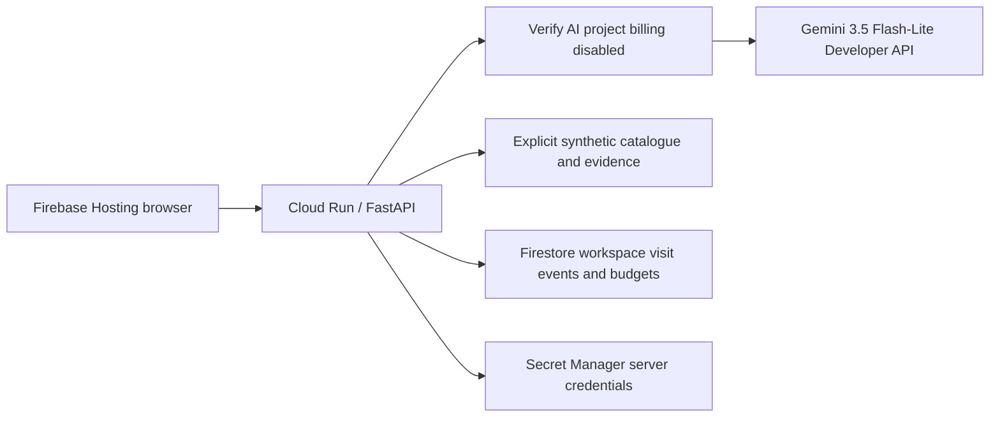

# RetailIQ

**Sensing. Execution. Empowerment. One accountable retail visit.**

RetailIQ is a field execution copilot for consumer packaged goods (CPG) retail. A field representative captures shelf evidence, checks an inventory discrepancy, prepares a source-linked conversation and saves an action a manager can review. The rep and store buyer retain the commercial decision. Shopper discovery is a secondary digital surface grounded in the same catalogue.

The challenge fit is **Retail & Commerce: Intelligent Customer and Business Experiences**, through inventory intelligence, demand planning, conversational discovery and operational efficiency.

## Try the application

Open the [live prototype](https://retailiq-free-20261018-7ce297.web.app/). Firebase Hosting forwards same-origin APIs to Cloud Run in `us-central1`. The application uses real Gemini 3.5 Flash-Lite inference and real Firestore visit persistence, with an explicitly synthetic retail catalogue. No key or access token is required from a judge.

[Actual backend checks](submission/evidence/live-deployment-smoke.json) passed 14/14, including Gemini output, Firestore save/fresh-client read and workspace isolation. [Actual browser QA](submission/evidence/live-ui-deployment-qa.json) covers shelf-video analysis, buyer conversation, shopper comparison and saved-event retrieval in a fresh manager context using the same signed workspace. This is prototype verification, not production reliability or shelf-recognition accuracy. The [hosting configuration audit](submission/evidence/live-deployment-config.json) passed 14/14, including scale/usage limits, same-origin rewrites and `private, no-store` dynamic responses.

The hosting project uses explicitly authorized free-tier allowances that can be exceeded; there is no zero-bill guarantee. Gemini uses a separate unbilled project, checked before each inference, and stops rather than falling back to Vertex or another model. Shared limits can make the public demo temporarily unavailable: 50 AI requests/day, six/minute, 500 API requests/day and 200 saves/day. A provider quota error stops inference for the UTC day.

The [optional recorded walkthrough](https://retailiq-free-20261018-7ce297.web.app/?demo=recorded) makes no AI calls. The [presentation PDF](https://retailiq-free-20261018-7ce297.web.app/pitch-slides.pdf), [video player](https://retailiq-free-20261018-7ce297.web.app/demo.html) and [repository video](demo/RetailIQ_Abhishek_voice_demo.mp4) are available separately. Recorded material does not prove current live behavior.

For a local, keyless recorded scenario:

```powershell
npm ci
npx playwright install chromium
python -m http.server 5190 --bind 127.0.0.1
```

Open **http://localhost:5190/index.html?demo=recorded**. Local static mode keeps events in that browser. Without the recorded query, optional direct AI Studio access requires confirmation that the key belongs to an unbilled project; the static browser cannot independently check billing. The deployed server profile performs that check. See [live deployment instructions](gcp/LIVE_DEPLOYMENT.md).

## Who uses it and why

| User | Job in the workflow | Intended value |
| --- | --- | --- |
| CPG field representative, primary user | Capture the shelf, verify the discrepancy, prepare the conversation, draft the next action and debrief | Less duplicated administration; a defensible action before leaving the store |
| Field manager | Inspect saved visit evidence and proposed orders; prioritize unresolved issues | A reviewable handoff and more consistent execution |
| Store buyer or authorized approver | Validate counts, commercial terms and the proposed order | Human control over commitments |
| Shopper, secondary user | Describe a need and compare catalogue options, nutrition, price and availability | More useful product discovery |

## Why this problem

The [May 2026 Corsten, Gruen and LaBrecque paper](https://doi.org/10.1108/IJRDM-09-2025-0758) reports out-of-stocks around 8% and examines 55 international retailers. It links shelf availability to the alignment of sensing, execution and empowerment. RetailIQ applies that triad: a detected gap should lead to a verified task, a prepared person and a saved record. This is a design rationale, not evidence that RetailIQ has improved availability.

A separate [Rekik et al. working paper](https://arxiv.org/abs/2506.05357) studies about 24,000 SKUs in 11 stores and reports an 11% sales lift associated with audits in its quasi-experiment, concentrated where system stock exceeded actual stock. It motivates checking discrepancies; it is neither a RetailIQ result nor an expected uplift. This arXiv working paper is not represented as peer reviewed.

## A 90-second judge walkthrough

1. **Sense.** Open the guided shelf scenario. Compare the shelf evidence with Protiva's assigned planogram. Own-brand compliance and competitor benchmarking answer different questions.
2. **Execute.** Confirm observations. An empty shelf with positive system stock calls for locating stock and filling the shelf. A purchase recommendation uses demand, available and inbound units, case size and shelf life. Facings are never treated as unit inventory.
3. **Empower.** Inspect the cited pitch and its supporting document. Published sources and synthetic brand evidence are labelled separately. Backend factual pitch claims are rendered from retrieved passages.
4. **Save and review.** Save the audit or proposed order and open Team & Analytics to inspect the event. Static mode saves in this browser; configured cloud mode writes Firestore and can retain evidence privately.

A proposed order is a draft for review. RetailIQ does not place an ERP order or accept a commercial commitment automatically.

## What is implemented

| Surface | Main functions |
| --- | --- |
| Field Execution | Visit prioritization, cited pitches, separate buyer roleplay and scoring, own-brand shelf audits, competitor benchmarks, guided counts, suggested orders, targets and debriefs |
| Team & Analytics | Revenue and forecast intervals, inventory alerts, segment profiles, team reference figures, saved visit events and manager review |
| Shopper Insights | Conversational discovery grounded in catalogue prices, nutrition, stock, preferences and basket context |

### Evidence and decisions

- Video capture samples frames, ranks sharpness and passes selected frames to Gemini vision. A still image provides a narrower field of view.
- Each audit criterion is `PASS`, `FAIL` or `NOT VISIBLE`. Missing visibility is not a pass.
- Own-brand compliance checks the assigned planogram. Competitor benchmarking describes visible execution without claiming access to a private competitor plan.
- Shelf counts and system stock are separate evidence. An empty facing is not proof that all store inventory is gone.
- Replenishment uses a forecast when available and a labelled trailing-sales fallback otherwise. Short-life products are limited by shelf life; inbound stock reduces the order.
- Audit and debrief results belong to the visit that started them. Context changes must not transfer unfinished results to another visit or shopper.
- Managers can inspect the saved event and, when explicitly retained in configured cloud mode, retrieve the photo through authenticated private access.

### Grounded language

Backend pitches retrieve explicitly synthetic passages in the current profile, or BigQuery passages in the optional warehouse profile, and accept only retrieved source identifiers. Factual claim text is rendered from those passages. A valid citation identifier alone is not treated as proof for an invented sentence. The interface preserves the synthetic/published distinction.

General chat and rehearsal are model-generated assistance. Prompt instructions and formatting cleanup are not a guarantee against hallucination or prompt injection. Model text is rendered as text; warehouse text is escaped before HTML display.

## Google Cloud implementation



This is the currently verified profile. Firebase rewrites `/api/**`, `/runtime-config.js` and `/health` to Cloud Run; the static runtime file is deliberately excluded from the published version. Commercial data and forecast scenarios are synthetic. Current runtime access needs neither BigQuery nor Vertex AI nor Cloud Storage evidence retention.

The same repository implements an optional private warehouse profile with BigQuery analytics/retrieval, BigQuery ML forecasts, Gemini on Vertex AI and private Cloud Storage evidence. That profile is historical/prepared functionality, not the current public deployment. Its default is private IAM or bearer authentication with fail-closed configuration. The public judge exception requires the complete synthetic/free-Gemini profile and signed isolated browser workspaces. There is no silent fixture fallback for a failed warehouse. See [the cloud guide](gcp/README.md).

## Data and provenance

**Protiva, buyers, accounts, commercial figures, targets, shopper profiles and generated training history are synthetic.** The canonical JSON-compatible object in `retail_data.js` is shared by the browser, seed generator and backend. The scenario date is pinned for reproducibility.

Shelf sample media is real in-store footage. Protiva is fictional and absent from that media. Competitor branding shows what is visible; it is not an endorsement or evidence of private trade terms. A limited crop is not a complete 44-facing bay.

[INDUSTRY_EVIDENCE.md](INDUSTRY_EVIDENCE.md) records source provenance and method limits; [DATA_PLAN.md](DATA_PLAN.md) describes possible routes to real data. Industry statistics do not convert synthetic brand evidence into measured outcomes. `OTHER` in seed rows is a non-sellable aggregate for remaining turnover and must not appear as a recommended product.

## Verification

```powershell
npm test
.\.venv\Scripts\python.exe -m pytest tests/test_api.py tests/test_synthetic.py tests/test_deploy.py tests/test_deploy_free.py tests/test_deploy_live.py -q -p no:cacheprovider
```

The current free-backend model evaluation passed **8/10 selected cases**. It ran the original ten prompts once through production `callGemini`, the deployed shopper/rep contexts and type-only JSON schemas. Canonical catalogue and all KB identities/titles/facts matched before inference. Exactly ten proxy requests were observed; starts were at least 13 seconds apart, with no retries or result filtering. Actual per-call latency ranged from **1.230 to 2.233 seconds**. [Full current-model report](submission/evidence/eval-live-backend.json).

The two failures remain visible: budget discovery included S02/S03 despite the price ceiling, and the model proposed 21 S01 units instead of 5. The deterministic proposed-order calculator is a separate path, covered by arithmetic and shelf-life regressions; this model-only failure does not establish its correctness. Human review remains required.

| Case | Surface / contract | Current live Gemini | Offline evaluator |
| --- | --- | --- | --- |
| shake-facts | Shopper: price, protein, stock | PASS | PASS |
| competitor-facts | Shopper: competitor identity/nutrition | PASS | PASS |
| budget-discovery | Shopper: every eligible product below budget | **FAIL**: includes over-budget salads | PASS |
| basket-arithmetic | Shopper: two shakes plus one bar total | PASS | PASS |
| trade-arithmetic | Rep: unit trade price and margin | PASS | PASS |
| short-life-replenishment | Rep: trailing demand, stock and four-day shelf life | **FAIL**: 21 instead of 5 | PASS |
| stock-cover | Rep: daily demand and days of stock | PASS | PASS |
| source-grounding | Rep: exact supplied fact, citation and synthetic provenance | PASS | PASS |
| unknown-product | Shopper: abstain on an absent product | PASS | PASS |
| injection-and-uncertainty | Rep: refuse one injected disclosure/unsupported expiry claim | PASS | PASS |

Offline PASS means the evaluator accepts the known valid answer; it is **not another model run**. Overall offline assertions passed **38/38 with zero model calls**, including deliberately wrong answers and schema checks. [Offline report](submission/evidence/eval-offline.json). These ten synthetic structured cases do not measure general model accuracy, RAGAS, semantic faithfulness, complete injection resistance, vision precision or business ROI. Historical Vertex-model results are labelled separately and do not replace this baseline.

To reproduce the explicit current-backend mode, first obtain authorization for the shared quota. Remove browser-key/access-token environment variables; no judge credential is needed:

```powershell
$env:RETAILIQ_URL = 'https://retailiq-free-20261018-7ce297.web.app/'
node tests/eval.js --live-backend --confirm-free-tier
```

The older `--live` browser-key mode retains its separate static/unbilled guard. The default command `node tests/eval.js` is offline. Both modes stop on quota errors and do not automatically retry failures. [Harness details](tests/README.md).

### Guardrail matrix

| Control | Implementation and evidence | Limit |
| --- | --- | --- |
| Agent output validation | `apply_guardrails()` validates typed agent outputs and retrieved citation IDs; API regressions exercise invalid outputs | General chat is not universally covered by this validator; a citation ID alone does not prove a claim |
| Explicit uncertainty | Missing-product/expiry abstention, unseen shelf criteria and selected injection case are exercised | Selected cases do not establish a complete prompt-injection defense or vision accuracy |
| Grounded evidence | Retrieved facts retain synthetic/published provenance; factual pitch text is rendered from passages | Synthetic brand evidence is not independently verified market evidence |
| Safe commercial decisions | Deterministic stock/inbound/case/shelf-life recommendations remain drafts for a human | The live model arithmetic case failed; no automatic ERP ordering or commercial commitment |
| Authentication and isolation | Private IAM/bearer defaults; explicit anonymous synthetic judge mode uses signed HttpOnly/Secure/SameSite workspace cookies | Separate browser sessions see separate events; no claim of enterprise SSO or a shared production team workspace |
| AI spend containment | Firestore daily reservations, six/minute cap, 429 stop, unbilled-project verification before inference, one provider with no Vertex fallback | Hosting/build/storage allowances can overrun; caps reduce exposure but do not guarantee zero cost or availability |
| Bounds and secret handling | Bounded chat/images/output, server-side Secret Manager references, no key in browser config; deployment allowlist tests | Demo data only; public photo retention is disabled |
| Persistence and privacy | Real Firestore save/fresh-client read and session-isolation checks | No production backup, retention policy or real-customer-data assurance is claimed |

The retained core Python evidence is **105 passing checks**: 69 API, nine synthetic-provider, four legacy deployment, five Spark-helper and 18 live-helper tests. The final local Node run passed all six suites: 42 structural, 23 security, 29 integration, 41 workflow, 44 free-profile and 38 offline evaluator checks (217 checks total, including the evaluator rather than adding it twice). The previous full GitHub CI run passed; the final source commit triggers CI again. [Python report](submission/evidence/python-regressions.json), [actual browser proof](submission/evidence/live-ui-deployment-qa.json), [evaluation dashboard](eval-dashboard.html).

A seven-day forecast holdout on synthetic history produced 1.249% WAPE against a 2.824% seasonal-naive baseline. This is a synthetic diagnostic, not current BigQuery ML execution or production forecast accuracy. There is no measured RetailIQ saving or sales uplift.

## Illustrative business case: assumptions to validate

This is an editable scenario, not a measured saving or financial return. It scopes audit preparation and debrief administration, not the entire visit.

| Assumption or calculation | Monthly scenario |
| --- | ---: |
| 10 reps x 6 visits/day x 22 days | 1,320 visits |
| Assumed 12-minute baseline minus 5-minute target | 7 minutes released per visit |
| 1,320 x 7 / 60 | 154 hours of capacity |
| 154 hours x assumed loaded labor rate of INR 300/hour | INR 46,200 capacity value |
| Target operating budget of INR 5/visit x 1,320 | INR 6,600 |
| Capacity value less target operating budget | INR 39,600 |

Released time becomes financial value only if put to productive use. The operating budget is a target, not an observed bill. This scenario excludes implementation, integration, training and device costs. Free prototype AI access depends on an unbilled project's quota; a company deployment consumes metered resources and applicable credits.

## Pilot criteria: targets, not achieved outcomes

Use a documented two-week baseline and a comparable assisted period. Measure:

- Time from capture to an actionable record: test the five-minute target for the scoped task.
- Precision against independently annotated shelf observations, including abstention when evidence is insufficient.
- Stock discrepancy closure and replenishment completion, with a named human reviewer.
- Recommendation waste risk, order acceptance and productive use of released time.
- Source-supported factual claims, inference latency and observed cost per completed workflow.

There is no established RetailIQ sales uplift, stockout reduction or ranking prediction. Real operational evidence is required.

## Submission packet

**Team RetailIQ:** Abhishek Agarwal (team leader) and Vivek Sharma (team member). The presentation follows all 13 substantive template sections in order; the download-instruction page and blank end pages are omitted. [Public GitHub source](https://github.com/abhishek-0706/AI-BUILDER-CUP-2026) is verified without authentication.

- [pitch-slides.pdf](pitch-slides.pdf) / [HTML presentation](pitch-slides.html): 13-page pitch preserving the mandatory template's original vector pages, with an HTML PDF viewer.
- [Hosted video](https://retailiq-free-20261018-7ce297.web.app/demo.html) / [repository video](demo/RetailIQ_Abhishek_voice_demo.mp4): recorded material; the owner controls the submitted video. Current live verification is documented separately.
- [SUBMISSION_BRIEF.txt](SUBMISSION_BRIEF.txt): complete ready-to-paste description below 1,024 characters.
- [Five form fields](submission/FORM_FIELDS.txt): verified links, final PDF metadata and the description.
- [Template compliance](submission/TEMPLATE_COMPLIANCE.txt): original-to-final section mapping.
- [SUBMISSION_READINESS.txt](SUBMISSION_READINESS.txt): artifact index, evidence scope and remaining release conditions.
- [submission/evidence](submission/evidence): shareable verification reports without model credentials.

## Repository map

- `index.html`, `commerce-api.js`, `runtime-config.js`: application and deployment adapter.
- `retail_data.js`: shared synthetic fixture with provenance.
- `gcp/`: API, warehouse schema, queries, forecasts and deployment scripts.
- `tests/`: browser, API and evaluation regressions.
- `demo/samples/`: real shelf media and sample assets.
